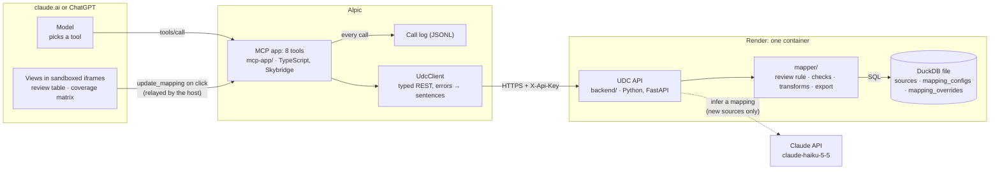
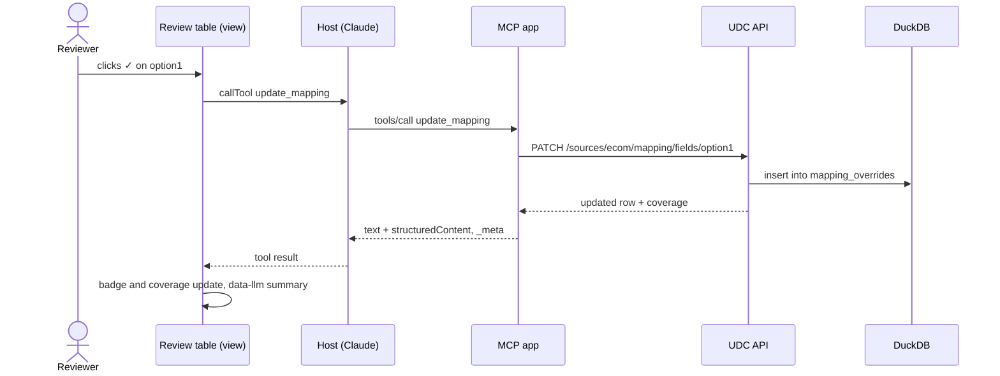
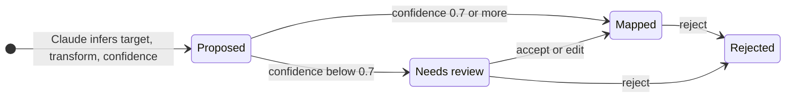
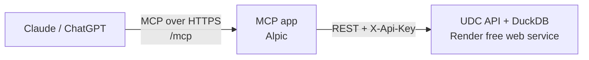

# Architecture

This document describes how the Universal Data Connector (UDC) and its MCP App fit
together: the parts, how a request moves through them, where the rules live, and
where each piece sits in the code. To run, demo or deploy it, see
[mcp-app/README.md](mcp-app/README.md).

## What it does

Maison Vellandre, a fictional luxury brand, keeps product data in three systems that
name the same things differently. UDC maps each source onto one core **Product**
model. Claude proposes a target field, a transform and a confidence for every source
column. A person decides the uncertain ones in a review table that opens inside
Claude or ChatGPT. UDC then validates the result and exports it as a dbt model,
PySpark code or a JSON spec.

| Source | Columns | What makes it hard |
|---|---|---|
| ERP (SAP-style) | `MATNR` `MAKTX` `MTART` `MATKL` `NETPR` `WAERS` `LABST` `ERSDA` | German number format (`1.250,00`; `12,000` means 12 units), `YYYYMMDD` dates, zero-padded SKUs that must stay text, no brand |
| PIM | `product_ref` `title_fr` `title_en` `brand_name` `collection` `material_composition` `colour_code` `size_label` | Colours as codes (`NR`, `IV`), names in two languages, no price |
| E-commerce | `handle` `variant_sku` `title` `product_type` `price` `compare_at_price` `option1` `option2` `inventory_qty` | `option1`/`option2` hold a colour for some products and a size for others; no brand, no currency |

The Product model:
- **Required:** `sku`, `name`, `brand`, `category`, `price.amount`, `price.currency`.
- **Optional:** `material`, `color`, `size`, `stock_quantity`, `created_at`.

## The parts

| Part | Code | Runs on | Job |
|---|---|---|---|
| Host | not ours | claude.ai, ChatGPT | Runs the model, renders the views, relays the views' tool calls |
| MCP app | [`mcp-app/`](mcp-app/) (TypeScript, Skybridge 2.1, React) | Alpic | 8 tools and 2 views over the UDC REST API; holds no data |
| UDC API | [`backend/`](backend/) (Python 3.12, FastAPI) | Render (Docker) | System of record: sources, mappings, review rule, validation, export |
| DuckDB | opened by the API | inside the API container | Three tables: `sources`, `mapping_configs`, `mapping_overrides` |
| Claude API | not ours | Anthropic | Proposes mappings with a forced tool call, so every column gets a structured answer |

## Design decisions

1. **UDC plays the customer's system.** The MCP app wraps an existing REST API
   rather than reaching into its code or database. It calls the API over HTTPS with
   an `X-Api-Key`, the way it would call a client's API.
2. **The MCP app holds no state.** Skybridge serves MCP statelessly (a fresh server
   per request, no session id), so the app keeps nothing between calls. Every
   decision made in the table is written to UDC at once, and every tool reads the
   current state back from it.
3. **The rules live in the API.** The review rule, required-field coverage,
   validation and export are all computed by the API. The app renames fields and
   words the results. Any other client of the API gets the same rules.
4. **Each tool result has two audiences.** The text and `structuredContent` go to
   the model: a short summary of what needs review and which required fields are
   missing. `_meta` goes only to the view: every row with its sample values,
   reasoning and confidence, plus the coverage header. The model's context stays
   small, and the view has what it needs to draw.
5. **Decisions are append-only.** Each inference is a new row in `mapping_configs`.
   Each human decision is a row in `mapping_overrides`, replayed in order on top of
   the latest inference. When inference runs again, accepted and edited decisions
   carry over. A rejection carries over only while Claude keeps proposing the same
   target.
6. **Errors tell the agent what to do next.** API errors name the fix, for example
   *"Source 'ecom' has no mapping yet. Run inference first (POST
   /sources/ecom/mapping)."* The app returns them to the model as tool errors, so
   the agent can recover on its own.
7. **One lock per store.** DuckDB connections are not safe to share across threads,
   and FastAPI runs sync routes in a thread pool. The stores serialize their methods
   with a lock ([`core/locking.py`](backend/src/udc/core/locking.py)). Without it,
   concurrent requests crashed the process.

## One click, end to end

What happens when a reviewer accepts a row in the table. This is what makes it an
MCP App rather than a plain MCP server: the view calls a tool by itself, with no
chat message.

The view never reaches the MCP app directly; the host carries the call both ways.
When the result arrives, the view stores the decision in its view state. It also
writes a one-line summary into a `data-llm` attribute, which Skybridge passes to the
model, so the model knows what was decided in the table.

## The review rule

- **Mapped:** a proposal at 0.7 or above counts as mapped unless someone changes it.
  A reviewer can still edit or reject it.
- **Needs review:** below 0.7, the row is highlighted in the table and left out of
  the export, with a warning, until someone decides.
- **Left out:** when Claude proposes to leave a column out (`drop`), the same rule
  applies. The column ends as *left out* instead of *mapped*.
- **Where it lives:** `mapping_state` in
  [`mapper/review.py`](backend/src/udc/mapper/review.py), with the threshold
  `REVIEW_THRESHOLD` in [`mapper/models.py`](backend/src/udc/mapper/models.py).

Two operations then work on the whole source:

- **Validate** (`POST /sources/{id}/mapping/validate`) checks for:
  - targets that don't exist;
  - type mismatches;
  - two columns feeding one field;
  - required fields with no source;
  - rows still pending review.

  It also runs the transforms on the sample rows (a dry run), so a value that won't
  convert shows up before anything is exported.
- **Export** (`GET /sources/{id}/mapping/export?format=json|dbt_sql|pyspark`)
  includes mapped columns only. A required field with no source comes out as `NULL`
  with a TODO comment. The dbt SQL uses DuckDB's dialect. A test runs it in DuckDB
  and compares the output with the Python dry run.

## Tools

| Tool | UDC route | View |
|---|---|---|
| `list_sources` | `GET /sources` | |
| `register_source` | `POST /sources` | |
| `get_core_model` | `GET /schemas/Product` | |
| `propose_mapping` | `GET /sources/{id}/mapping` (`POST` on first call or with `refresh`) | `mapping-review` |
| `update_mapping` | `PATCH /sources/{id}/mapping/fields/{col}` | |
| `validate_mapping` | `POST /sources/{id}/mapping/validate` | |
| `export_mapping` | `GET /sources/{id}/mapping/export` | |
| `get_coverage` | `GET /coverage` | `coverage-matrix` |

The coverage matrix's *Review* button sends a chat message ("Open the mapping review
for the erp source."), and the model answers it with `propose_mapping`.

## Code map

### `mcp-app/`: the MCP App

| Path | What it does |
|---|---|
| `src/server.ts` | Declares the 8 tools, the instructions the model reads first, and which tools open a view |
| `src/lib/schemas.ts` | Input and output schemas of every tool (zod); their descriptions are what the model reads |
| `src/lib/udc-client.ts` | Typed client for the UDC API: adds the key, applies timeouts, turns HTTP errors into sentences |
| `src/lib/present.ts` | Shapes results: short text for the model, full rows for the view, error results |
| `src/lib/call-log.ts` | When `UDC_TOOL_LOG` is set, writes one JSON line per tool call (tool, arguments, error, latency, client) |
| `src/lib/config.ts` | Environment: API URL, API key, timeouts, log path |
| `src/views/mapping-review.tsx` | The review table: confidence badges, rows under 0.7 highlighted, accept / reject / target dropdown, coverage header, Validate panel |
| `src/views/coverage-matrix.tsx` | Required fields × sources grid, with a *Review* button per source |
| `src/views/components/shared.tsx` | Theme frame, confidence badge, loading and error states |
| `tests/` | A real MCP client talks to the app in memory, with UDC replaced by recorded API responses |
| `scripts/smoke.ts` | Calls every tool against a running server over HTTP (`npm run smoke`) |
| `FRICTION_LOG.md` | Product feedback on Skybridge and Alpic gathered while building |

### `backend/src/udc/`: the UDC API

| Path | What it does |
|---|---|
| `api/app.py` | Builds the app; loads the demo data at startup (`SEED_DEMO`); requires `X-Api-Key` everywhere except `/health` (`REQUIRE_API_KEY`) |
| `api/routers/sources.py` | The routes the MCP app uses: sources, mapping, field decisions, validate, export, coverage |
| `api/routers/schemas.py` | The core models (`GET /schemas/Product`) |
| `api/dependencies.py` | Shared stores and the API key check |
| `mapper/canonical.py` | The core models (Product, Contact, Order): type, required flag and meaning of each field |
| `mapper/mapper.py`, `mapper/prompt.py` | The Claude call: column statistics and samples in, one structured answer per column out |
| `mapper/service.py` | Runs an inference while keeping earlier decisions; applies one decision |
| `mapper/review.py` | The review rule, required-field coverage, validation checks |
| `mapper/transform.py` | Applies a mapping to rows: casts, `parse_decimal`, `parse_date`, value maps (`NR → Black`); used for the dry run |
| `mapper/export.py` | JSON spec, dbt SQL and PySpark generation |
| `mapper/store.py` | Versioned mappings and append-only decisions |
| `core/source_store.py` | Registered sources: declared fields and sample rows |
| `core/sampler.py` | Column statistics for the prompt: inferred type, nulls, distinct values, min, max, examples |
| `core/locking.py` | The per-store lock (see design decision 7) |
| `core/config.py` | Settings from the environment |
| `demo/` | The three fictional sources and real Claude proposals recorded once; `make demo-record` records them again |

`backend/deploy/` holds the cloud image (`Dockerfile`), the Render deploy script and
a Hugging Face Spaces alternative.

### From the first version of UDC

These parts predate the MCP App and are not on its path:
- `connectors/` (CSV, JSON API, Postgres) and `writers/` (DuckDB, Parquet, Postgres);
- `core/sync.py` (incremental sync) and `core/versioning.py` (schema diffs);
- `mapper/reconcile.py` (merging two sources on a key);
- `api/routers/mappings.py` (generic mapping routes);
- `cli/`, a stub that prints the version;
- `frontend/`, a Dockerfile with no app yet;
- `infra/docker-compose.yml`.

The MCP App registers sources from sample rows instead of going through connectors.

### Tests and CI

| Location | Contents |
|---|---|
| `tests/unit/` | Python tests (pytest), including the review rule, export (dbt SQL executed in DuckDB), store concurrency and the API key guard |
| `tests/integration/` | Postgres connector tests |
| `mcp-app/tests/` | MCP App tests (vitest) |
| `.github/workflows/ci.yml` | Lint (ruff), types (mypy), Python tests, and the MCP app's build, type check and tests |

## Deployment

- **MCP app on Alpic** (`make deploy-mcp`):
  - configured with `UDC_API_URL` and `UDC_API_KEY`;
  - backend timeouts are 75 s (120 s for inference) because the free API sleeps.
- **UDC API on Render** (`make deploy-backend`):
  - built from `backend/deploy/Dockerfile`, with `SEED_DEMO=true` and `REQUIRE_API_KEY=true`;
  - the DuckDB file is in `/tmp`, so data resets to the demo state on every restart;
  - the service sleeps after 15 idle minutes and takes about a minute to wake.
- **No Anthropic key on Render.** The demo serves the recorded proposals. Asking
  for a new source's mapping returns a 503 that says so.
- **Secrets stay out of git.**
  - `ANTHROPIC_API_KEY` and `RENDER_API_KEY` are only in `backend/.env`.
  - The demo API key is in `backend/.env`, on Render as `API_KEY` and on Alpic as
    `UDC_API_KEY`.
  - `mcp-app/.env.deploy` is generated by the deploy script.
  - All of these files are gitignored.
