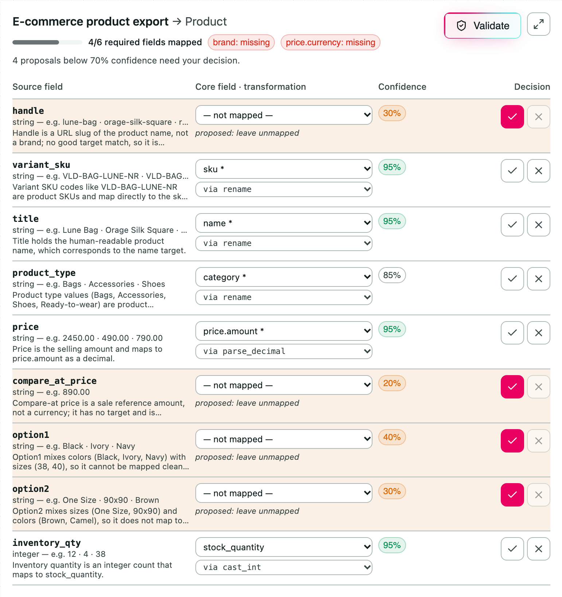
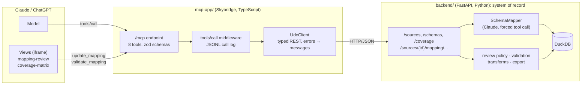
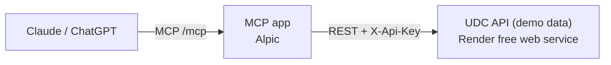
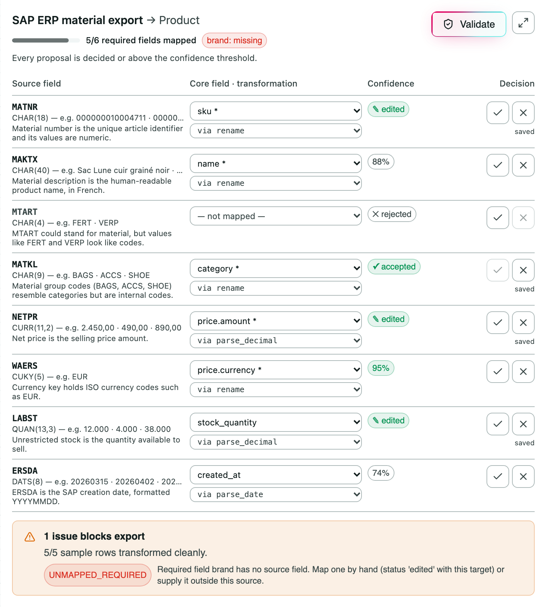
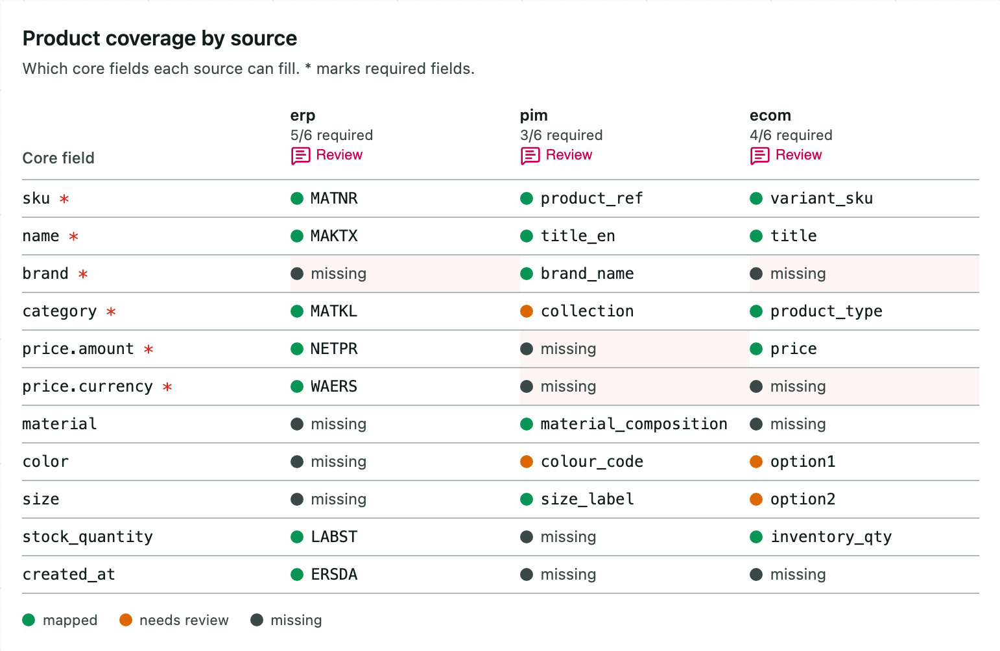
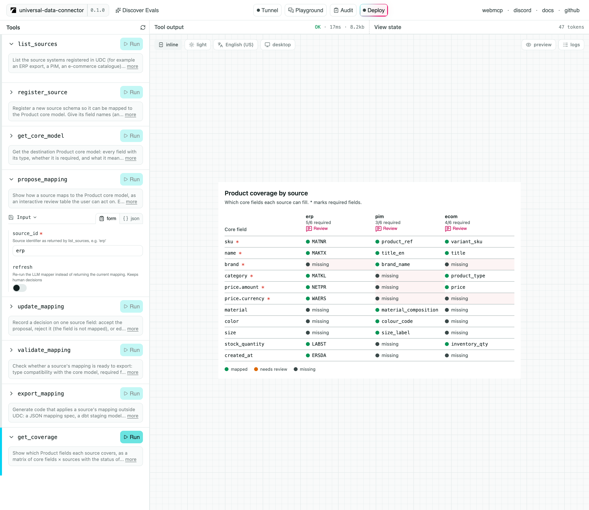

# UDC Mapping Review — an MCP App for Claude and ChatGPT

An [MCP App](https://modelcontextprotocol.io/docs/extensions/apps) built with
[Skybridge](https://docs.skybridge.tech) that brings the
**Universal Data Connector** (UDC) into Claude and ChatGPT. An agent can list a
company's product sources, show the proposed mapping of a source to the core
**Product** model as an interactive table, validate it with a dry run, and export
it as a dbt model or PySpark code.

**The LLM proposes, the human decides.** UDC's mapper proposes a target field,
transformation, confidence and rationale for every source field. Anything below
0.7 confidence is decided by the user, in the table or in the chat.

The demo scenario is fictional: *Maison Vellandre*, a luxury house consolidating
an SAP ERP export, a PIM and an e-commerce catalogue.



## Architecture

UDC is treated as the customer's existing system. This app wraps its REST API and
does not duplicate any mapping logic: sources, mapping state, transformations,
the review rule, validation and code generation all live in UDC. The app shapes
results for the model and the views, and words errors so the agent can recover.



Skybridge serves MCP statelessly (a fresh server per request), so nothing is kept
in the app: every decision made in the table is written to UDC straight away.

The whole repository (review rule, data model, code map, deployment) is described in
[ARCHITECTURE.md](../ARCHITECTURE.md).

## Tools

| Tool | What it does | Writes? |
|---|---|---|
| `list_sources` | Registered sources with review status and required-field coverage | no |
| `register_source` | Add a source schema (fields and/or sample rows) | yes |
| `get_core_model` | The Product model: fields, types, required flags, meanings | no |
| `propose_mapping` → **view `mapping-review`** | The mapping of one source as a review table; infers it on first call | yes (first inference) |
| `update_mapping` | Accept / reject / edit one field; called by the table, or by the agent when the user says so | yes |
| `validate_mapping` | Type checks, unmapped required fields, pending decisions, dry run on sample rows | no |
| `export_mapping` | JSON spec, dbt staging model (DuckDB SQL) or PySpark function | no |
| `get_coverage` → **view `coverage-matrix`** | Core fields × sources: mapped / needs review / missing | no |

Input and output schemas are in [`src/lib/schemas.ts`](src/lib/schemas.ts); the
product spec is [`SPEC.md`](SPEC.md).

Errors come back as `isError` results whose text says what to do, for example
`Unknown source_id 'sap'. Registered sources: erp, pim, ecom.`, never a stack trace.

## Run it locally

Prerequisites: Node 24+, [uv](https://docs.astral.sh/uv/) (it installs Python 3.11+
for the backend). An Anthropic API key is **optional**: the demo ships with
recorded mapping proposals, and only re-running inference (`refresh=true`, or
mapping a newly registered source) calls Claude.

```bash
# 1. UDC backend on :8000 with the demo data (fresh database on each start)
make demo-api

# 2. MCP app on :3000, in another terminal
cd mcp-app
npm install
npm run dev
```

- MCP endpoint: `http://localhost:3000/mcp`
- DevTools (emulator): `http://localhost:3000/`. Pick a tool, enter its input,
  click **Run**, and the view renders with theme / locale / device controls.
  **preview** shows it inside a mock Claude or ChatGPT conversation.
- Smoke test over HTTP: `npm run smoke`

`npm run dev` prints nothing when its output is not a terminal (in an agent
shell, for example); the server is still up on port 3000.

### Configuration

Set in the environment or in `mcp-app/.env`:

| Variable | Default | Purpose |
|---|---|---|
| `UDC_API_URL` | `http://localhost:8000` | UDC backend |
| `UDC_API_KEY` | — | Sent as `X-Api-Key` (needed by the backend's auth branch) |
| `UDC_TIMEOUT_MS` | `20000` | Per-request timeout |
| `UDC_INFER_TIMEOUT_MS` | `90000` | Timeout for live inference |
| `UDC_TOOL_LOG` | — | Path of a JSONL file; when set, every tool call is logged |

For live inference, put `ANTHROPIC_API_KEY` in `backend/.env`
(create one at <https://platform.claude.com/settings/keys>). `make demo-record`
then replaces the recorded demo proposals with real Claude runs.

## Connect it to Claude and ChatGPT

Both hosts reach MCP servers over the internet, so expose the local server
through an [Alpic tunnel](https://docs.skybridge.tech/test/tunnel). The Alpic CLI
asks you to log in first (`npx alpic login`, or set `ALPIC_API_KEY`).

```bash
cd mcp-app
npm run dev:tunnel        # prints https://<name>.alpic.dev/mcp
```

The tunnel URL is stable across restarts, and view edits hot-reload in the host.

**Behind a corporate proxy** (Zscaler, Netskope…), the tunnel may fail with
*"Cannot open tunnel: exited with code 1"*. The proxy re-signs HTTPS with a company
certificate that the OS trusts but Node.js doesn't (`DEBUG='pipenet*' npx alpic
tunnel --port 3000` shows `unable to get local issuer certificate`). Make Node use
the system certificates:

```bash
NODE_USE_SYSTEM_CA=1 npm run dev:tunnel
```

The same applies to `npm run smoke` against the public URL. Some networks also
cut the tunnel's raw connection to the tunnel server (port 3001): the CLI still says
*Forwarding*, but the public URL answers 404. In that case, deploy instead (below).

## Deploy to the cloud

A public deployment needs no tunnel: the MCP app runs on Alpic and calls the UDC
API on a free Render web service, protected by an API key.



1. **Backend**: put `RENDER_API_KEY=...` (from Render, *Account Settings → API keys*)
   in `backend/.env`, then run `make deploy-backend`. The script creates the service
   (Docker image `backend/deploy/Dockerfile`), sets `REQUIRE_API_KEY=true` with a
   generated key, waits until the API is live, and writes `mcp-app/.env.deploy`.
2. **MCP app**: run `npx alpic login` once, then `make deploy-mcp`. It deploys
   `mcp-app/` with the backend URL and key from `.env.deploy`, and prints the public
   URL (`https://<project>.alpic.live`). Add `/mcp` to it in Claude or ChatGPT.

Render's free services sleep after 15 minutes without traffic and take about a minute
to wake, so the app uses 75-second backend timeouts. Before a demo, open the API's
`/health` once to wake it. The data resets whenever the service restarts.

**Claude** (paid plan): Settings → Connectors (Customize → Connectors) →
*Add custom connector* → name `UDC` and the `/mcp` URL → *Add*. In a new
conversation, enable it from the `+` menu.

**ChatGPT** (Plus, Pro, Business, Enterprise or Edu): turn on
*Settings → Security and login → Developer mode*, then go to
<https://chatgpt.com/plugins>, **+**, give a name and the `/mcp` URL, authentication
*No Authentication*, *Create*. In a new chat, select it with **+** or `@UDC`.

Hosts cache tool definitions: after changing a tool's name, description or
schema, refresh the connector / plugin.

## Demo script

Start from a fresh demo (`make demo-api`). The proposals are real `claude-haiku-5-5`
output, recorded once (see [Known limitations](#known-limitations)). Five prompts,
about three minutes:

1. **"Which product sources do we have in UDC, and which ones are ready?"**
   → `list_sources`. Three sources, all *needs review*.
2. **"Show me how the e-commerce export maps to our Product model."**
   → `propose_mapping` renders the table. The mapper is confident about the SKU,
   name, category, price and stock, and hesitant about four highlighted columns:
   `option1`/`option2` (it noticed they hold colours for some products and sizes
   for others), `handle` (a URL slug) and `compare_at_price`. It proposes to leave
   them out; accept each in the table (✓ = keep it unmapped). `brand` and
   `price.currency` stay missing: this export has neither.
3. **"The PIM colours are codes like NR and IV. Map them to colour names."**
   → `update_mapping` on `colour_code` with `map_values` (NR → Black, IV → Ivory…),
   then `validate_mapping`, whose dry-run preview shows names. The mapper had
   mapped the codes as is at 82%, above the threshold, so it took a human reading
   the samples to catch it.
4. **"Where can each required Product field come from across ERP, PIM and e-commerce?"**
   → `get_coverage` renders the matrix: `brand` only from the PIM,
   `price.currency` only from the ERP, and the PIM has no price at all.
5. **"Is the ERP mapping ready? Export it as a dbt model."**
   → `validate_mapping`: the dry run is clean (the mapper kept the zero-padded
   `MATNR` as text, read the German-format prices with `parse_decimal` and the
   `YYYYMMDD` dates with `parse_date`); `brand` is the only blocker and MTART (the
   SAP *material type*) is still undecided at 40%, which the agent should ask
   about rather than decide. Then `export_mapping` returns `stg_erp__product.sql`,
   with `brand` as a NULL column and a TODO.

Optional sixth prompt, with an API key: paste a few rows of a new export,
*"Register this as the wms source and map it."*, which runs `register_source`
then live inference.

## Screenshots

| | |
|---|---|
| E-commerce, as proposed: four hesitant proposals for the user |  |
| ERP after accepting MTART and clicking Validate |  |
| Coverage matrix |  |
| Skybridge DevTools |  |
| In Claude | *placeholder: `docs/screenshots/claude.png`* |
| In ChatGPT | *placeholder: `docs/screenshots/chatgpt.png`* |

## Tests

```bash
npm test            # tool handlers, error paths, call log (vitest)
npm run typecheck   # src + tests
make test           # backend (pytest), from the repo root
```

The tool tests use a real MCP client over an in-memory transport (the pattern
Skybridge uses for its own tests). UDC is replaced by responses captured from the
running backend ([`tests/fixtures/udc-responses.json`](tests/fixtures/udc-responses.json)),
so the TypeScript side is checked against the API's real shapes.

## Tool-call log (groundwork for agent evaluation)

With `UDC_TOOL_LOG=./logs/tool-calls.jsonl`, the `tools/call` middleware appends
one line per call:

```json
{"ts":"2026-11-24T14:51:12.005Z","session_id":null,"session_source":"none",
 "client":"node","tool":"propose_mapping","args":{"source_id":"sap"},
 "is_error":true,"error_kind":"not_found",
 "error":"Unknown source_id 'sap'. Registered sources: erp, pim, ecom.",
 "result_summary":{},"latency_ms":4}
```

- `args` are compacted (long strings and arrays cut); `result_summary` keeps counts
  and scalars, never the payload.
- `session_id` is the best id the host gives: ChatGPT's `openai/session`, else an
  `mcp-session-id` header, else `null`. `session_source` says which, because a
  stateless server has no MCP session of its own.
- `client` is the client name from the request `_meta` when present, else the
  HTTP user agent.
- Calls made by the view (accept / reject / validate) are logged like any other;
  nothing in the request distinguishes them from model calls.

## Known limitations

- **Live inference needs a key**: without `ANTHROPIC_API_KEY` on the backend, a
  source without a recorded mapping can be registered but not mapped (the tool
  says so).
- **The demo replays recorded proposals**, from `claude-haiku-5-5` on 2026-11-24
  (see `_provenance` in `backend/src/udc/demo/data/recorded/`), so it needs no key
  and gives the same result every time. `make demo-record` re-rolls them, and runs
  differ: MATKL scored 60% on one run and 85% on the next. `refresh=true` runs
  inference live.
- **Required fields with no source** (`price.currency` for e-commerce) can only be
  surfaced, not filled: UDC has no constant/default transform.
- **`option1` / `option2`** change meaning by product type. The mapper itself
  proposes to leave them out (30–40%); mapping them per row would need a
  conditional transform UDC doesn't have, so size and color come from the PIM.
- **Value maps are set from chat**: the table can switch a field to
  `map_values` but has no editor for the map itself; the agent sets it with
  `update_mapping` (demo prompt 3).
- **The model may not see table decisions** (ChatGPT pushes an inline view's
  state only at mount, and Claude can evict view state), so the server
  instructions tell the agent to re-read the mapping before summarising or
  exporting.
- **A table doesn't refresh itself**: it shows decisions made in it. A decision
  the agent applies through chat appears the next time the table is shown
  (`propose_mapping` again).
- **No auth**: fine for a local demo and tunnel, not for production.
